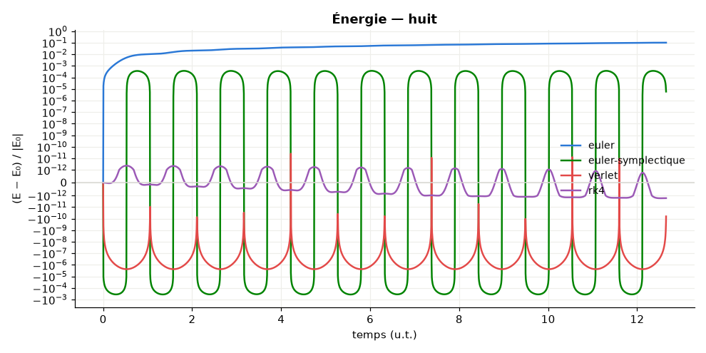
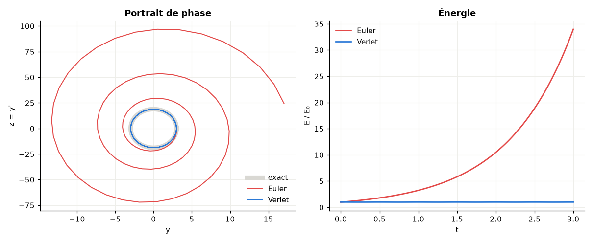
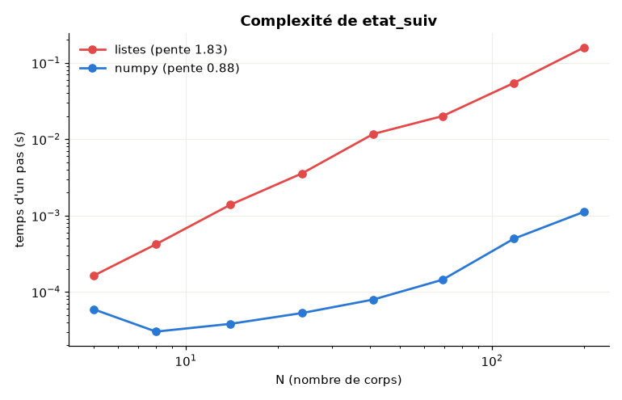

# dynamique_gravitationnelle

Modélise les interactions gravitationnelles entre planètes et corps célestes : problème à
N corps, schémas d'intégration comparés à une solution de référence, grandeurs conservées,
et base SQL de corps. Basé sur le sujet *Centrale Info 2015* (`centrale-info-2015-sujet.pdf`).

## Installation et utilisation

```sh
pip install -r requirements.txt
python -m pytest -q                                   # 34 tests

python -m gravitation cas                             # tous les scénarios, bilan des invariants
python -m gravitation orbite solaire --graphique
python -m gravitation comparer huit --duree 12.65     # Euler / Euler symplectique / Verlet / RK4 vs scipy
python -m gravitation oscillateur --sauver figures    # II.B.3 : Euler diverge, Verlet non
python -m gravitation complexite --nmax 200           # III.B.4-5 : pente log-log
python -m gravitation base                            # partie IV : base SQL, sélection, simulation
```

`python main.py <commande>` est équivalent. `--graphique` affiche les figures, `--sauver DOSSIER`
les enregistre en PNG. `--duree` et `--pas` s'expriment dans l'unité du scénario (jours, ou unités
sans dimension pour le « huit »). Depuis Python :

```python
from gravitation import simuler, bilan
from gravitation.systemes import systeme_solaire

traj = simuler(systeme_solaire(), duree=10 * 365.25 * 86400, h=43200, methode="verlet")
print(bilan(traj))        # dérive relative de E, du moment cinétique, de la quantité de mouvement
```

## Scénarios

| Nom | Contenu | Ce qu'il illustre |
|---|---|---|
| `terre-lune` | Lune en orbite circulaire | période de Kepler retrouvée à 0,1 % |
| `soleil-terre` | Terre autour du Soleil | énergie conservée à 1e-9 sur un an |
| `solaire` | Soleil + 8 planètes | 9 corps, orbites de 88 jours à 165 ans |
| `huit` | 3 corps égaux en « huit » (G = 1) | solution périodique exacte : test d'intégrateur |

## Schémas d'intégration

Sur le « huit » (2 périodes, pas 0,002) — `python -m gravitation comparer huit --duree 12.65` :

| Schéma | Ordre | Dérive de E | Erreur position finale | Temps |
|---|:-:|---:|---:|---:|
| `euler` | 1 | 1,0e-1 | 1,1 | 0,11 s |
| `euler-symplectique` | 1 | 3,7e-4 | 5,8e-3 | 0,11 s |
| `verlet` | 2 | 2,4e-6 | 3,3e-5 | 0,13 s |
| `rk4` | 4 | 2,3e-12 | 3,3e-9 | 0,54 s |

- **Euler explicite** ne conserve pas l'énergie : sur l'oscillateur, `E_{i+1} = (1 + h²ω²)·E_i`,
  donc l'énergie croît sans limite et la trajectoire spirale vers l'extérieur.
- **Verlet** est symplectique : l'énergie oscille autour de sa valeur sans dériver, avec **un seul**
  calcul de forces par pas (l'accélération finale d'un pas sert au suivant).
- **RK4** est le plus précis à pas égal, mais il ne conserve pas exactement le caractère
  hamiltonien et coûte quatre évaluations par pas : pour de très longues durées, Verlet reste préférable.
- La référence est un Dormand–Prince d'ordre 8 à pas adaptatif (`scipy.integrate.solve_ivp`).




## Complexité de `etat_suiv` (III.B)

Chaque pas évalue N·(N−1) interactions : **O(N²)**. La version « sujet » en listes Python suit bien
une droite de pente ≈ 2 en log-log ; la version numpy (`accelerations`) calcule les mêmes forces
100 à 150 fois plus vite dès N ≈ 40 (aux très petits N, le surcoût fixe de numpy masque la pente).



## Base de corps célestes (IV)

`gravitation/base.py` : tables `CORPS(id_corps, nom, masse)` et
`ETAT(id_corps, datem, x, y, z, vx, vy, vz)` (UA, km/s, jours), avec les requêtes du sujet :

- **IV.A** `SELECT masse FROM CORPS` → `Base.masses()`
- **IV.B.1** `COUNT(DISTINCT id_corps) … WHERE datem < :tmin` → `nb_corps_connus_avant(tmin)`
- **IV.B.2** `MAX(datem) … GROUP BY id_corps` → `dernieres_dates(tmin)`
- **IV.B.3** masse, position, vitesse des corps de masse ≥ `masse_min` dans le cube d'arête
  `arete`, triés par distance à l'origine → `selectionner(tmin, masse_min, arete)`, qui renvoie
  directement un `Systeme` prêt à simuler (conversion UA, km/s → m, m/s)

`enregistrer_trajectoire` réécrit les états simulés dans la base, qui devient le point de départ de
la simulation suivante.

## Organisation du code

| Fichier | Rôle |
|---|---|
| `gravitation/vecteurs.py` | `smul`, `vsom`, `vdif` (I.A) |
| `gravitation/edo.py` | `euler`, `verlet` pour y'' = f(y), oscillateur harmonique (II) |
| `gravitation/forces.py` | `force2`, `forceN` (listes) et `accelerations` (numpy) (III.A) |
| `gravitation/integrateurs.py` | `pos_suiv`, `etat_suiv` (listes) ; `simuler` (4 schémas) ; référence scipy |
| `gravitation/systemes.py` | `Systeme`, scénarios, référentiel barycentrique |
| `gravitation/diagnostics.py` | énergie, moment cinétique, quantité de mouvement, période |
| `gravitation/base.py` | base SQLite et requêtes du sujet (IV) |
| `gravitation/bench.py`, `visualisation.py` | mesures de complexité, graphiques |
| `gravitation/cli.py` | ligne de commande |
| `tests/test_gravitation.py` | 34 tests hors ligne |

## Ce qui a changé par rapport à la première version

- Les scripts ne s'exécutaient pas seuls : `etats_suiv.py` et `pos_suiv.py` utilisaient des
  variables définies dans d'autres fichiers, et `force2` était copiée trois fois.
- `imulation_verlet.py` mélangeait les unités : positions en UA et vitesses en km/s injectées
  telles quelles dans des formules en SI. Tout est maintenant en SI, la conversion se fait aux
  frontières (base de données, affichage).
- Chaque pas recalculait les forces trois fois par corps ; il n'y a plus qu'une évaluation par pas
  (Verlet) et le calcul est vectorisé.
- `force2` divisait par zéro pour deux corps confondus : elle lève maintenant une erreur claire
  (ou `adoucissement` borne la force dans `accelerations`).
- `requete.sql` utilisait une vue `date_mesure` et des fonctions `tmin()`, `arete()`… qui
  n'existaient pas : les requêtes sont paramétrées et testées sur une vraie base SQLite.
- Ajouts : Euler symplectique et RK4, comparaison à une solution de référence, invariants,
  scénarios (dont le « huit » à trois corps), CLI, graphiques et tests.
- Les réponses théoriques du sujet, dont le README avait perdu la mise en forme des formules,
  sont résumées ci-dessus (Euler : `E_{i+1} = (1 + h²ω²)·E_i` ; Verlet : erreur d'énergie en
  O(h³) par pas ; complexité en O(N²)).

## Reprise de l'existant des autres projets

- **Six-degree** : même organisation en paquet (`cli.py`, `__main__.py`, `tests/`) et `scipy`,
  utilisé ici pour la solution de référence.
- **algoTrade** : sous-commandes, « cas illustrés » (tableau de bilan par scénario), option
  `--sauver`, palette des graphiques et style des tests.
